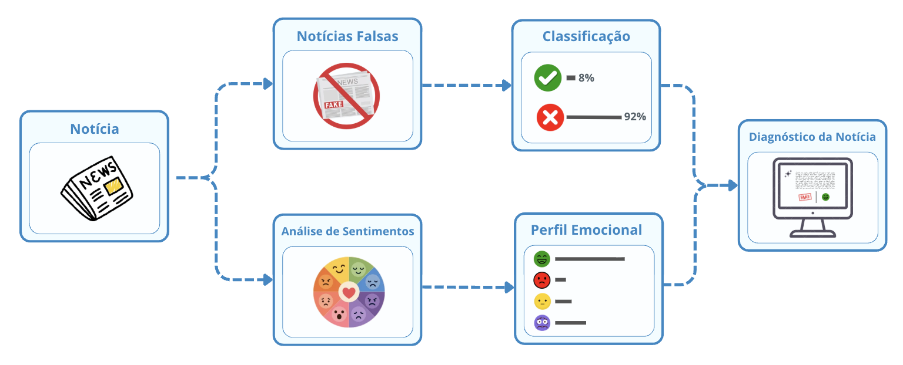

# Deteção de Notícias Falsas e Análise de Emoções em Português

Trabalho final de Computação de Linguagem Natural (UBI).

O sistema recebe uma notícia em português e faz duas análises:

1. **Classificação da notícia** como verdadeira ou falsa (Fake.Br).
2. **Análise de emoções**, frase a frase, com 28 emoções (GoEmotions PT-BR), e um perfil emocional da notícia completa.

## Esquema do Sistema



## Modelos e Demonstração

| Recurso | Link |
|---|---|
| Modelo de notícias falsas (BERTimbau) | [tiagomfmarques/bertimbau-fakenews-pt](https://huggingface.co/tiagomfmarques/bertimbau-fakenews-pt) |
| Modelo de emoções (XLM-RoBERTa) | [tiagomfmarques/xlmr-emocoes-pt](https://huggingface.co/tiagomfmarques/xlmr-emocoes-pt) |
| Demonstração | [Hugging Face Space](https://huggingface.co/spaces/tiagomfmarques/analise-noticias-pt) |

## Resultados

Foram comparados quatro modelos em cada tarefa: TF-IDF + Regressão Logística (baseline), BERTimbau, Albertina e XLM-RoBERTa.

| Tarefa | Melhor modelo | Métrica principal |
|---|---|---|
| Notícias falsas | BERTimbau | F1 macro = 0,897 |
| Emoções | XLM-RoBERTa | F1 macro = 0,773 (F1 micro = 0,678) |

## Estrutura

```
data/            dados brutos e processados
src/data/        pré-processamento
src/training/    treino dos modelos
src/evaluation/  métricas e comparação
src/inference/   inferência e testes
src/app/         aplicação Streamlit
hf_space/        versão da aplicação para o Hugging Face
```

## Instalação

```bash
pip install -r requirements.txt
```

## Utilização

**Pré-processamento**
```bash
python src/data/preprocess.py --raw <pasta do Fake.Br-Corpus>
python src/data/preprocess_emocoes.py
```

**Treino**
```bash
python src/training/train_baseline.py
python src/training/train_fakenews.py --modelo bertimbau
python src/training/train_baseline_sentiment.py
python src/training/train_sentiment.py --modelo xlmr
```

**Comparação**
```bash
python src/evaluation/compare_models.py --tarefa fakenews
python src/evaluation/compare_models.py --tarefa sentiment
```

**Testar**
```bash
python src/inference/testar_fakenews.py --texto "Texto da notícia..."
python src/inference/testar_sentiment.py --noticia noticia.txt
```

**Aplicação**
```bash
streamlit run src/app/streamlit_app.py
```

Depois de descarregados os modelos, a aplicação funciona sem ligação à internet.

## Dados

- [Fake.Br Corpus](https://github.com/roneysco/Fake.br-Corpus): 7 200 notícias (3 600 verdadeiras e 3 600 falsas).
- [GoEmotions PT-BR](https://huggingface.co/datasets/antoniomenezes/go_emotions_ptbr): 53 870 textos anotados com 28 emoções.